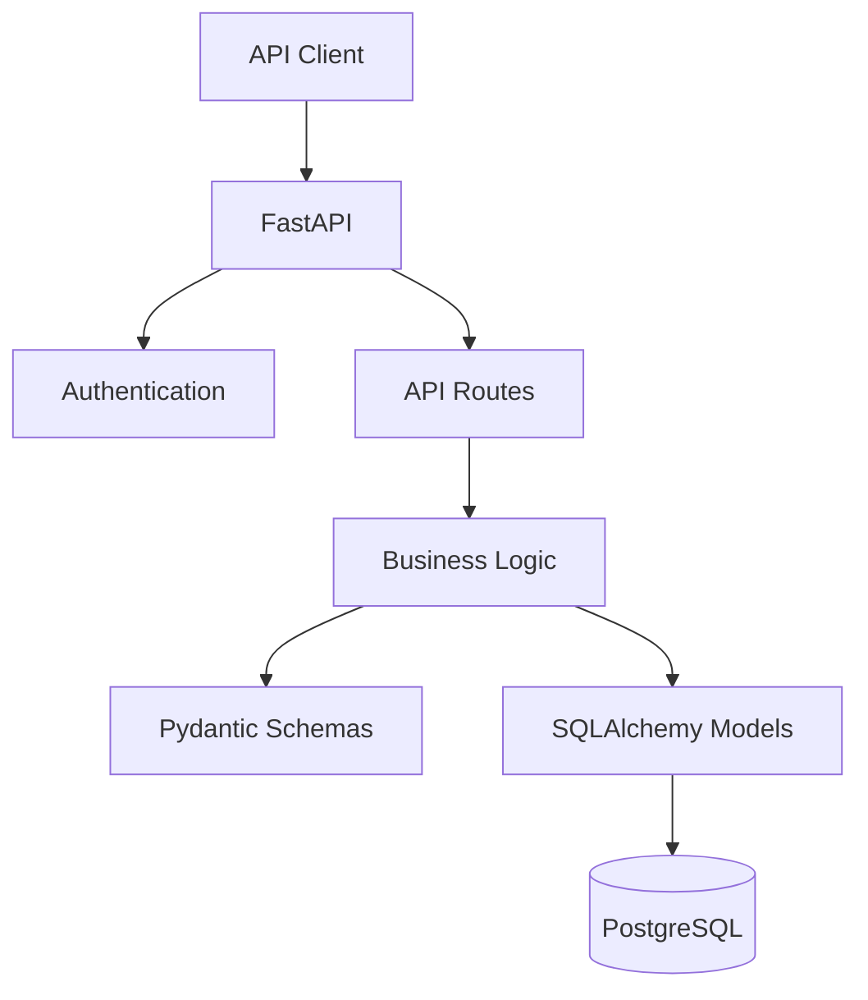

# SplitSync — Expense Splitter API

A backend REST API for managing shared expenses between users and groups.

SplitSync allows users to create groups, add members, record shared expenses, calculate balances, simplify debts, and settle payments.


---

## Features

- JWT authentication with Argon2 password hashing
- Group creation and member management
- Expense splitting:
  - Equal
  - Exact
  - Percentage
- Automatic balance calculation
- Debt simplification
- Settlements
- Group-based authorization
- Input validation
- Async database operations
- PostgreSQL with SQLAlchemy
- Alembic migrations

---

## Architecture



### Request Flow

```text
Client
  ↓
FastAPI Route
  ↓
Authentication / Validation
  ↓
Business Logic
  ↓
SQLAlchemy
  ↓
PostgreSQL
```
# Key Backend Logic
Expense Splitting

Supports three splitting strategies:

Equal — divides an expense equally between members
Exact — assigns specific amounts to members
Percentage — calculates each member's share from a percentage

Balance & Debt Simplification

The system calculates each member's net balance and simplifies debts to reduce unnecessary transactions.

Members can record payments between users to settle outstanding balances.

## Tech Stack

- **Python** — Backend
- **FastAPI** — REST API
- **PostgreSQL** — Database
- **SQLAlchemy** — ORM
- **Alembic** — Database migrations
- **Pydantic** — Data validation
- **JWT** — Authentication
- **Argon2** — Password hashing
- **Pytest** — Testing


## Project Structure

```text
SplitSync/
├── alembic/
│   ├── versions/
│   │   └── 865ff7b30dbb_initial_tables.py
│   ├── env.py
│   ├── README
│   └── script.py.mako
│
├── app/
│   ├── api/
│   │   ├── auth.py
│   │   ├── balances.py
│   │   ├── deps.py
│   │   ├── expenses.py
│   │   ├── groups.py
│   │   └── settlements.py
│   │
│   ├── core/
│   │   ├── config.py
│   │   └── security.py
│   │
│   ├── db/
│   │   └── session.py
│   │
│   ├── models/
│   │   ├── base.py
│   │   ├── expense.py
│   │   ├── group.py
│   │   ├── settlement.py
│   │   ├── split.py
│   │   └── user.py
│   │
│   ├── schemas/
│   │   ├── balance.py
│   │   ├── expense.py
│   │   ├── group.py
│   │   ├── settlement.py
│   │   ├── split.py
│   │   └── user.py
│   │
│   ├── services/
│   │   ├── balance_service.py
│   │   ├── debt_simplifier.py
│   │   └── split_calculator.py
│   │
│   ├── __init__.py
│   └── main.py
│
├── tests/
│   ├── test_debt_simplifier.py
│   ├── test_split.py
│   └── __init__.py
│
├── .env
├── .gitignore
├── alembic.ini
├── README.md
└── requirements.txt
```
## Setup

### 1. Clone the repository

```bash
git clone https://github.com/dev-Maira/SplitSync.git
cd SplitSync
```

### 2. Install dependencies

```bash
pip install -r requirements.txt
```

### 3. Configure environment variables

Create a `.env` file:

```env
DATABASE_URL=your_postgresql_database_url
SECRET_KEY=your_secret_key
ALGORITHM=HS256
ACCESS_TOKEN_EXPIRE_MINUTES=30
```

### 4. Run database migrations

```bash
alembic upgrade head
```

### 5. Start the server

```bash
uvicorn app.main:app --reload
```

API: `http://127.0.0.1:8000`

Swagger documentation: `http://127.0.0.1:8000/docs`

# Testing
Run the test suite with:
pytest
 

Interactive API documentation is available through Swagger at /docs.

Project Focus:

SplitSync was built to practice backend engineering beyond basic CRUD, with a focus on:

Relational database design
Many-to-many relationships
Authentication & authorization
Financial calculations using Decimal
Business-rule validation
Balance calculation
Debt simplification
Settlement logic